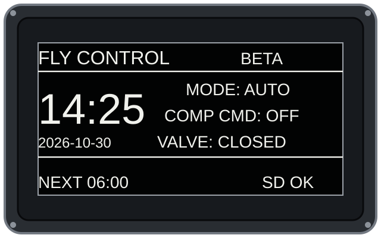
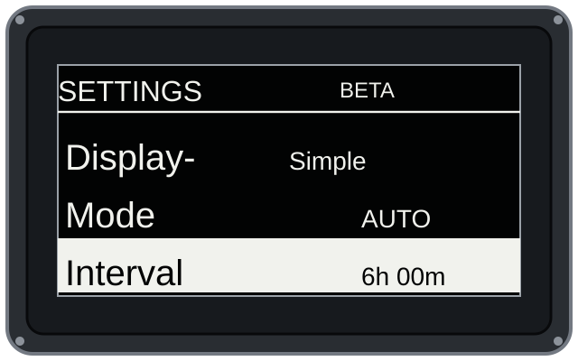
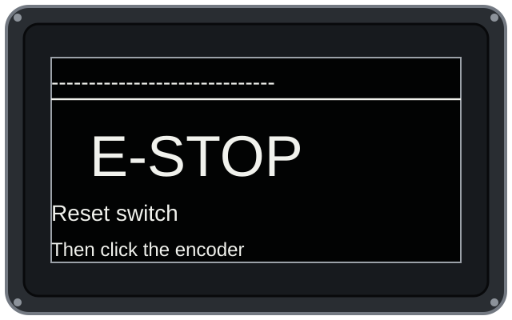

# Fly Control

An Arduino Mega 2560 fly-control project with hardware notes, documented cycle-control findings, troubleshooting history, and interface previews. Arduino firmware source files are not included in this repository. The older Cirkit Designer ILI9341 TFT investigation, the documented ST7920-based design, and the Rev A mainboard interface brief describe distinct design contexts; their differences and unresolved pin assignments are documented below.

## Project links

- [Open the Cirkit Designer project](https://app.cirkitdesigner.com/project/24b07511-9851-44f0-a418-0e4dbb4c1f2e)
- [GitHub repository](https://github.com/M3nta1Ins/fly-control-arduino)

## Repository contents

| Path | Purpose |
|---|---|
| [`hardware/ValveController_Mainboard_RevA/DESIGN_BRIEF.md`](hardware/ValveController_Mainboard_RevA/DESIGN_BRIEF.md) | Preliminary Rev A board interface definition; not a manufacturing package. |
| [`docs/interface-previews/`](docs/interface-previews/) | Illustrative home, settings, and E-stop screen previews based on the documented primary design. |
| `README.md` | Circuit findings, cycle behavior, known differences between design contexts, and remaining checks. |

## Documented primary design and cycle behavior

The documented primary design targets an Arduino Mega 2560 with an Ender 3 ENH12864Z-1 display using the ST7920 controller, a DS3231 RTC, an SD card, a rotary encoder, two active-low relay inputs, and a normally closed emergency-stop input. The display uses software SPI on D6–D8 so the SD card can use the Mega hardware SPI bus (MISO D50, MOSI D51, SCK D52, CS D53). Relay commands are on D30 and D31; the E-stop input is on D25. The control outputs are relay signals; the actuator loads are not wired in the described setup. Firmware source files are not included in this repository.

| Documented primary-design function | Mega pin | Notes |
|---|---:|---|
| ST7920 display clock / E | D6 | Software SPI |
| ST7920 display data / SID | D7 | Software SPI |
| ST7920 display chip select / RS | D8 | Software SPI |
| Encoder A | D22 | LCD module pin 5 |
| Encoder B | D23 | LCD module pin 8 |
| Encoder push button | D24 | LCD module pin 9 |
| Normally closed E-stop input | D25 | Pull-up input; open circuit latches a stop |
| Compressor relay command | D30 | Active-low relay input |
| Valve relay command | D31 | Active-low relay input |
| RTC SDA / SCL | D20 / D21 | Mega hardware I2C |
| SD MISO / MOSI / SCK / CS | D50 / D51 / D52 / D53 | Mega hardware SPI |

In the documented cycle design, a cycle starts by energizing the compressor relay while keeping the valve relay off for a 2-second compressor lead-in. It then opens the valve for the configured valve time, adjustable from 1 to 60 seconds (default 5 seconds). When that timer expires, the intended behavior is to de-energize **both** relay outputs and mark the cycle idle in the same cycle-finish pass. The compressor command therefore ends with the cycle instead of remaining on after the valve closes.

The documented automatic mode uses the configured interval to schedule the next cycle. If a long cycle outlasts that deadline, the documented behavior defers the next cycle by a full interval after completion, preventing an immediate compressor restart. Manual cycles are started from the settings menu. An open or broken normally closed E-stop circuit is documented to latch the stop and disable both outputs; after the circuit closes again, encoder acknowledgment clears the latch but does not start a cycle automatically. Relay tests are separate short diagnostics and are blocked while a cycle or an output is active. These are findings about the documented design; the source code is not included here.

The E-stop is a software input and does not independently disconnect load power. Do not route mains or compressor/valve load current through the logic board. The hardware needs a correctly rated hardwired safety interruption for the actual supply and load before actuator use.

## Interface previews

The following are illustrative mockups of the documented 128×64 ST7920 interface design. They are not photographs or captures of a physical device. The home example shows the normal state after a cycle has ended, with the compressor command off and the valve closed.

| Home screen | Settings menu | Emergency stop |
|---|---|---|
|  |  |  |

## Components in the Cirkit Designer circuit

- Arduino Mega 2560 controller
- ILI9341 SPI TFT display (the display under investigation)
- microSD card module / Cirkit MicroSD VFS simulator component
- DS3231 RTC module using I2C (`Wire` / `RTClib`)
- Matrix keypad (`Keypad` library)
- Four-channel 5 V relay module
- A separate character LCD is also visible in the circuit, but it is not part of the TFT issue and is treated as unrelated for this investigation.

## Cirkit/TFT investigation pin assignments

These pin numbers apply to the historical Cirkit Designer ILI9341 TFT investigation, not to the primary ST7920 firmware above. They describe intended connections and do not prove that every wire terminates on the correct component pin.

| ILI9341 signal | Arduino Mega 2560 pin |
| --- | ---: |
| CS | 53 |
| DC / RS | 48 |
| RESET | 49 |
| MOSI / SDI | 51 |
| SCK | 52 |
| MISO / SDO | Not connected; not required for display output |

The SD card uses chip select pin 47 and shares the Mega SPI bus. The TFT and SD card have separate chip-select pins. Mega hardware SPI uses pin 51 for MOSI, pin 52 for SCK, and pin 50 for MISO. The SD card needs its SPI signals for storage access; display-only TFT writes do not require TFT MISO. The previous visual review indicated the TFT power and backlight were connected to 3.3 V with a common ground, but the full set of wire endpoints was not conclusively verified.

For the Cirkit/TFT investigation, the RTC uses I2C on Mega pins SDA 20 and SCL 21. Its keypad row/column and four-channel relay IN1–IN4 mappings were not recorded, so those simulator-design connections still need to be traced before hardware use. The separate documented primary-design pin map is listed above.

## Cirkit/TFT firmware findings

The earlier Cirkit/TFT sketch used the Arduino `SPI`, `SD`, and `Wire` libraries, Adafruit GFX and Adafruit ILI9341, RTClib, and Keypad. Its TFT object used CS 53, DC 48, and RESET 49. During that investigation, the display was initialized, set to rotation 1, and cleared using the project background color.

During troubleshooting, startup was updated to explicitly call `SPI.begin()` and set both TFT CS 53 and SD CS 47 inactive (HIGH) before TFT initialization. This is intended to prevent either device from being selected while the shared SPI bus is starting. No circuit wiring was changed.

## Cirkit/TFT problem being investigated

The ILI9341 remains completely black in the Cirkit Designer simulation. The program compiles and runs, but no TFT output is visible. The simulation console reports:

```text
SD CARD: OK
SD LOG: SYSTEM START
```

This confirms that the sketch starts and the simulated SD card initializes; it does not confirm that the TFT receives valid SPI commands or that the display model renders correctly. Earlier debug logs showed Arduino serial transmit/receive activity and relay-module status, but no clear TFT-specific error or success message. The LCD shown elsewhere in the design is considered irrelevant to this TFT fault.

## Troubleshooting completed

1. Identified the display as an ILI9341 SPI TFT and checked the sketch pin definitions against the Mega hardware SPI pins.
2. Confirmed in the sketch that TFT CS 53 and SD CS 47 are distinct, so they are not assigned the same chip-select pin.
3. Added explicit SPI startup and deasserted both chip selects before calling `tft.begin()`.
4. Recompiled and restarted the Cirkit simulation. Compilation succeeded (reported as 37,996 bytes of program storage and 2,413 bytes of globals).
5. Confirmed that SD initialization and the startup log succeed, while the TFT still appears black.
6. Reviewed the more visible circuit layout. The intended SPI/control wiring appears plausible, but not every endpoint could be verified conclusively from the view, so a wiring fault has not been ruled out.

## Cirkit/TFT current assessment and open checks

The SPI startup change did not fix the simulated TFT. The cause is still undetermined. Possible areas to check are: exact wire endpoints and common ground; TFT module power/backlight and logic-level requirements; whether the module is truly an SPI ILI9341 variant; the simulator component model and its supported pin names; and whether the display drawing code runs after initialization. The SD success message alone cannot distinguish among these causes.

Next useful isolation step: run a minimal display-only test that initializes the ILI9341 and fills the screen with a bright color, with the SD card deselected. If that still produces a black simulation display, test the simulator model/pin mapping or the physical module separately. Keep the original circuit and code backed up before any further changes.

## Cirkit/TFT project status

- Board: Arduino Mega 2560
- Display: ILI9341 SPI TFT
- Cirkit simulation compile: successful after the SPI startup update
- SD initialization in simulation: successful
- TFT rendering in simulation: unresolved; black screen persists
- Every TFT wire endpoint: not conclusively verified
- Cirkit keypad row/column and four-channel relay IN1–IN4 maps: not documented here; the separate Rev A two-channel relay map is below
- Physical hardware test: not recorded
- Arduino `.ino` source files: omitted; documentation, findings, and interface previews are retained


## Rev A logic mainboard design findings

The [Valve Controller Mainboard Rev A design brief](hardware/ValveController_Mainboard_RevA/DESIGN_BRIEF.md) records a preliminary interface definition for a standalone Mega 2560-class logic board. It is not a finished PCB design or a fabrication release.

### Keep the design contexts distinct

The Cirkit Designer investigation documented above describes an ILI9341 TFT and a four-channel relay module. The documented primary design uses an ST7920 128x64 display and two relay outputs. The Rev A interface brief describes a preliminary character-LCD and external two-channel-relay interface. The available material does not establish that the Cirkit/TFT design is the same hardware revision as the documented primary design or Rev A board. No Arduino `.ino` source files are included in this repository.

There is also a pin assignment conflict that must be resolved before combining or routing the designs: the Cirkit/TFT findings use TFT chip select D53 and SD chip select D47, while the documented primary design and Rev A interface brief assign SD chip select D53 and do not include that TFT interface. Treat each map as applying to its stated design context until the hardware revision is confirmed.

### Rev A board architecture

- Standalone ATmega2560 board with USB-to-serial interface, following the Arduino Mega 2560 Rev3 reference design for clock, reset, programming, USB, and power sections.
- LCD, encoder, RTC breakout, SD breakout, and relay module connect as separate modules through keyed and labeled headers.
- The two-channel relay module stays external. The logic board sends low-voltage control signals; compressor and valve load wiring is not routed on this board.

### Rev A interface pin map

| Function | Mega-compatible pin | Board connection |
|---|---:|---|
| Character LCD SCLK | D6 | LCD header pin 5 |
| Character LCD SID / MOSI | D7 | LCD header pin 3 |
| Character LCD CS / RS | D8 | LCD header pin 4 |
| Encoder A | D22 | LCD header pin 7 |
| Encoder B | D23 | LCD header pin 8 |
| Encoder click | D24 | LCD header pin 9 |
| E-stop NC input | D25 | Two-pin E-stop terminal; other pin to GND |
| Relay 1 command (compressor) | D30 | Relay header IN1 |
| Relay 2 command (valve) | D31 | Relay header IN2 |
| RTC SDA | D20 / SDA | RTC header SDA |
| RTC SCL | D21 / SCL | RTC header SCL |
| SD MISO | D50 | SD header MISO |
| SD MOSI | D51 | SD header MOSI |
| SD SCK | D52 | SD header SCK |
| SD chip select | D53 | SD header CS |

The character LCD uses a 2x5 connector: 1=+5V, 2=GND, 3=SID, 4=CS/RS, 5=SCLK, 6=NC, 7=Encoder A, 8=Encoder B, 9=Encoder click, and 10=Beeper. The beeper is not currently used in the described interface. Confirm connector gender, key/orientation, and cable against the physical module before routing.

Suggested module header labels are RTC: `5V GND SDA SCL`; SD: `5V GND MISO MOSI SCK CS`; relay: `5V GND IN1 IN2`; and E-stop: `NC GND`. Verify each breakout's header order and 5V tolerance before connection.

### Safety and power boundaries

- The current single normally closed E-stop contact is only a software input. It does not independently disconnect compressor or valve power. The eventual load circuit needs a correctly rated hardwired safety interruption for its supply and load.
- Do not route mains or compressor/valve load current through the logic PCB.
- Power input, regulator, USB power isolation, board outline, mounting holes, enclosure, and connector dimensions remain to be selected.

### Open items before fabrication

1. Confirm the character LCD 2x5 connector, cable, and orientation against the physical module.
2. Confirm the SD and RTC breakout header orders and whether their 5V pins accept 5V.
3. Select the power input and define enclosure and mounting-hole dimensions.
4. Create the schematic and PCB layout, run electrical and layout checks, and prepare Gerber, drill, BOM, and assembly files.
5. Reconcile the Rev A SD chip select on D53 with the Cirkit/TFT map, where TFT CS is D53 and SD CS is D47, before treating the designs as one revision.

The mainboard document is an interface brief only. Do not use it as a fabrication package or order a board from it.
